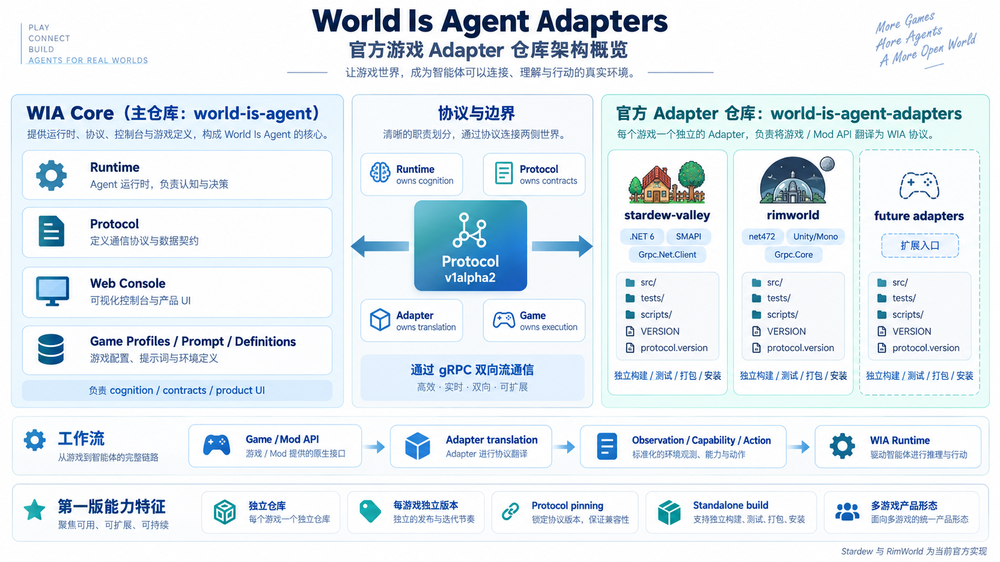

# World Is Agent Adapters

这里提供 **World Is Agent（WIA）** 的官方游戏 Adapter。Adapter 安装在游戏中，负责把游戏里的角色、事件和环境状态交给 WIA Runtime，并把 Runtime 决定的对话或行动带回游戏执行。



## 选择你的游戏

| 游戏 | Adapter 版本 | 需要安装 | 支持平台 | 详细说明 |
| --- | --- | --- | --- | --- |
| Stardew Valley | 0.1.1 | Stardew Valley、SMAPI | Windows | [安装与构建说明](stardew-valley/README.md) |
| RimWorld | 0.1.0 | RimWorld 1.6 | Windows x64 | [安装与构建说明](rimworld/README.md) |

每个游戏的 Adapter 独立安装、独立发布，版本也分别维护。你只需要安装自己所玩游戏对应的 Adapter。

## 安装和使用

1. 安装并启动 [WIA Runtime 0.2.0](https://github.com/zlci7/world-is-agent)。
2. 从本仓库的 [Releases](https://github.com/zlci7/world-is-agent-adapters/releases) 下载对应游戏的 Adapter 压缩包。
3. 按对应游戏的说明，把 Adapter 安装到游戏的 Mod 目录。
4. 在 Runtime Web 控制台中选择对应游戏，配置模型并等待状态变为 **Ready**。
5. 启动游戏、启用 Adapter 并加载存档。

当前发布包尚在最终验收阶段。如果 Releases 页面中没有所需版本，可以按游戏目录中的说明从源码构建；不要安装来源和版本不明确的包。

## 游戏怎样连接 Runtime

Runtime 默认监听 `127.0.0.1:50051`。Adapter 会在游戏启动后自动连接这个地址，因此 Web 控制台不需要填写游戏安装目录或手动配置端口。

建议先启动 Runtime 并选择游戏，再启动对应游戏。如果当前选择了另一个游戏，Adapter 会收到 `game_mismatch` 并继续重试；在控制台切换到正确游戏后，它会自动完成连接。

一个 Runtime 同一时间服务一个游戏。切换游戏会取消正在执行的回合，但不会删除已经记录的历史。

## 版本对应关系

| Runtime | 游戏 | Adapter | 发布包 |
| --- | --- | --- | --- |
| 0.2.0 | Stardew Valley | 0.1.1 | `wia-adapter-stardew-valley-v0.1.1.zip` |
| 0.2.0 | RimWorld | 0.1.0 | `wia-adapter-rimworld-v0.1.0.zip` |

Stardew Valley 和 RimWorld 分别发布，更新其中一个不会改变另一个的版本。

## 当前发布状态

两个游戏的基础实机闭环已经通过。正式发布前仍需完成运行时切换游戏、自动重连和修改模型的聚焦实机验收；对应 tag 和 GitHub Release 在验收通过后创建。

## 从源码构建

源码构建需要 .NET SDK 和与当前版本匹配的 WIA Protocol。Stardew Valley 还需要本机游戏与 SMAPI 的构建引用；RimWorld 使用固定版本的引用程序集。

- [构建 Stardew Valley Adapter](stardew-valley/README.md)
- [构建 RimWorld Adapter](rimworld/README.md)

仓库维护者可以运行架构检查：

```powershell
powershell -ExecutionPolicy Bypass -File scripts/check-architecture.ps1
```

源码迁移记录参见 [docs/migration.md](docs/migration.md)。

## 许可证

本项目使用 [MIT License](LICENSE)。每个游戏目录也包含一份许可证，便于独立分发。
